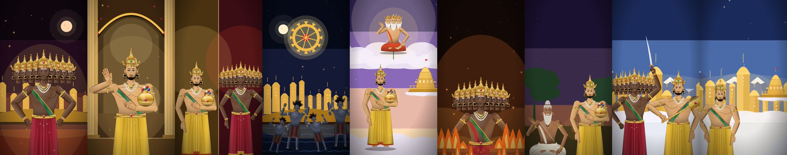

# Mahabharat Motion Kit

Turn a **voice-over** into a finished **vertical motion-graphics reel** (1080×1920, 60 fps) about Indian mythology
(Mahabharata, Ramayana, Puranas) in the style of the [@mahabharat.retold](https://www.instagram.com/mahabharat.retold/) reels.
The look is painted, realistic characters with jewellery, silk and natural hands; lit 2.5D scenes; a moving camera; music and
sound effects.



Everything is drawn in code (React + SVG with [Remotion](https://www.remotion.dev)) and runs on your own computer. There is no
image or video AI, no cloud API and no API key. A coding agent does the creative work: it writes the script from your audio,
plans the shots, codes the animation, checks the frames and renders the video, following the instructions in this repository.
**GitHub Copilot, Claude Code, Gemini CLI, Antigravity** and any other agent that reads `AGENTS.md` can be used.

## Quick start

1. **Clone**
   ```bash
   git clone https://github.com/SahilScripts/mahabharat-motion-kit.git
   cd mahabharat-motion-kit
   ./setup.sh
   ```
   `setup.sh` installs what's missing (Node, Python, ffmpeg, Remotion, Whisper; a few minutes and about 1.5 GB). It is
   done when it prints **READY**.
2. **Put your voice-over in a folder**: `reels/<name>/voiceover.mp3`. The name uses lowercase letters, digits and `-`,
   for example `reels/ram-setu/voiceover.mp3`.
3. **Ask your agent**, opened in this folder:
   - **GitHub Copilot** (VS Code → Copilot Chat → *Agent* mode): *"Make the reel from reels/ram-setu/voiceover.mp3,
     following AGENTS.md."* Copilot reads `.github/copilot-instructions.md` (the same text) automatically.
   - **Claude Code**: `claude` in the folder, then the same request (it reads `CLAUDE.md`).
   - **Gemini CLI**: `gemini` in the folder, then `/reel reels/ram-setu/voiceover.mp3` (it reads `GEMINI.md`).

   The agent works through: transcribe → exact script → storyboard → timing → animation code → still-frame review → sound
   effects → render. The video lands in `out/<name>.mp4`.

### Using it in the Gemini app

Download [`dist/mahabharat-motion-kit.zip`](dist/mahabharat-motion-kit.zip) (about 13 MB, well under Gemini's 100 MB limit)
and upload it as the skill in a Gemini task, together with your voice-over. Upload the zip, not the instructions alone: the
look comes from the kit's code (the characters and their hands, the sets, the India map, the sound and the render
pipeline), and an agent that only has the instructions has to draw everything from scratch.

Voice-over tips: clear narration, 45–90 s, one speaker. Hindi is the default; set `"language"` in `kit.config.json`
(for example `"en"`) for another language.

## The style reference

`remotion/src/examples/LankaKuber.tsx` is a complete reel ("सोने की लंका रावण की थी ही नहीं", 19 shots) and the reference every
new reel copies. To render it:
```bash
pipeline/render.sh example-lanka-kuber      # → out/example-lanka-kuber.mp4
```
Two more examples: `AsurRakshas.tsx` (Asur vs Rakshas, 18 shots) and `Sanjeevani.tsx` (Hanuman lifts the mountain, 13 shots).

## Hands and arms

Earlier versions drew an arm hanging at the side with a cupped, claw-like hand, and some reels forced the elbows inward, which
swung the upper arm across the chest. Both are fixed in `remotion/src/kit/real.tsx`:
- `HP.hang` is a relaxed resting hand: fingers together, nearly straight, hanging down from the wrist.
- Hanging arms keep the default elbow bend (outward). Reels never pass `rBend`/`lBend` for them.

Check it any time with the 12-second arm test, which runs through every arm preset:
```bash
cd remotion && npx remotion render KIT-arm-test ../out/arm-test.mp4
```

## Requirements
- macOS (Apple Silicon or Intel) or Linux (Debian/Ubuntu). On Windows, use WSL.
- 8 GB RAM is enough (renders use 3 parallel frames). About 2 GB of free disk space, plus about 1 GB per render for Remotion's
  temporary files (in your system temp folder; safe to delete when nothing is rendering).
- On macOS, [Homebrew](https://brew.sh) if Node, Python or ffmpeg aren't installed yet (setup tells you).

## What's inside
| path | |
|---|---|
| `AGENTS.md` | the agent's instructions: the rules and the 10-step workflow. `CLAUDE.md`, `GEMINI.md` and `.github/copilot-instructions.md` are the same text, for each agent |
| `.agents/skills/motion-reel/` | the detailed guides: storyboard craft, drawing-kit reference, review checklist, sound |
| `.gemini/commands/`, `.agents/workflows/` | `/reel` and `/setup` shortcuts for Gemini CLI and Antigravity |
| `SKILL.md`, `.gemini/skills/mahabharat-motion-kit/` | the kit as an Agent Skill, for agents that ask for a `SKILL.md` (Gemini CLI, Antigravity) |
| `dist/mahabharat-motion-kit.zip` | the whole kit as one zip (about 13 MB) with `SKILL.md` on top, for agents that take an uploaded skill file, like a Gemini task. Rebuild it with `pipeline/pack.sh` |
| `docs/examples/` | five finished reels made with the kit (360p copies) |
| `setup.sh` | installs everything and self-tests; safe to re-run |
| `pipeline/` | `transcribe.py` (local Whisper) · `timing.py` (cuts, music, mix) · `sfx.py` + `sfxlib.py` (synthesised effects) · `stills.sh`, `frames.sh`, `closeup.sh` (review) · `render.sh` · `cta.sh` (optional end card) |
| `remotion/src/kit/` | the drawing kit: realistic characters (`real.tsx`, `realcast.tsx`), shared sets and props (`sets.tsx`), camera and scenery (`scene.tsx`), India map (`india.tsx`), older flat cast and props (`cast*.tsx`), arm test, end card |
| `remotion/src/examples/` + `reels/example-*` | three complete reels with script, storyboard, voice-over and sound |
| `remotion/src/reels/` | your reels (start from `Template.tsx`; picked up automatically) |

## Doing it by hand
```bash
./setup.sh
mkdir -p reels/my-reel && cp ~/my-voiceover.mp3 reels/my-reel/voiceover.mp3
.venv/bin/python pipeline/transcribe.py my-reel        # then write reels/my-reel/script-hi.txt and storyboard.json
.venv/bin/python pipeline/timing.py my-reel             # → reels/my-reel/cues.txt
# code remotion/src/reels/MyReel.tsx from Template.tsx (REEL = "my-reel"), in the style of examples/LankaKuber.tsx
pipeline/stills.sh REEL-my-reel 1,4,8                   # look at frames
.venv/bin/python pipeline/sfx.py my-reel
pipeline/render.sh my-reel                              # → out/my-reel.mp4
```
Preview interactively with `cd remotion && npx remotion studio`.

## Customising
- **Characters**: add a `Look` and an `Outfit` (see `.agents/skills/motion-reel/references/kit.md`); look at them with
  `pipeline/stills.sh KIT-sheet-3 0`.
- **End card**: `pipeline/cta.sh <reel>` appends a 15 s Hindi "comment WORKFLOW" call to action. Replace
  `remotion/public/mg/cta/vo.mp3` with your own line and retime `T` in `remotion/src/kit/CtaCard.tsx`. Set
  `"end_card": true` in `kit.config.json` to have the agent add it every time.
- **Music level**: `MUSIC=0.25 .venv/bin/python pipeline/timing.py <reel>` (0 = no score).

## Notes
- No subtitles or on-screen text, by design: the pictures tell the story.
- Maps of India use Natural Earth's India-viewpoint boundaries (public domain), the only outline the kit allows.
- Remotion is free for individuals and small teams; larger companies need a [Remotion licence](https://www.remotion.dev/license).
- The example voice-overs and stills are the author's and are included for demonstration.
